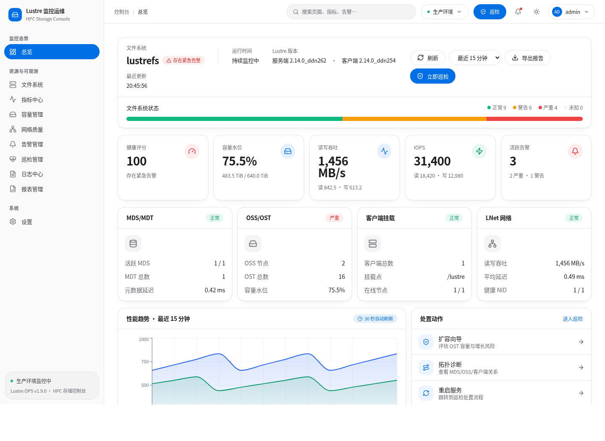

# Lustre OPS

Lustre OPS 是面向 Lustre 并行文件系统运维团队的中文图形化监控与诊断控制台。项目将文件系统状态、性能与容量指标、LNet 网络、告警、集群巡检、日志分析和知识库集中在一个 Web 工作台中，降低日常巡检和故障定位的操作成本。

> 当前版本：`v1.8.0`。界面改版覆盖全部模块：在 v1.7.0 基础上将告警、告警详情、巡检、文件系统、日志、设置、报表、容量、性能、网络等页面统一到 Apple 风格设计系统；新增应用版本单一来源与界面版本展示；README 版本历史改为倒序（最新在上）。生产环境部署前请先阅读[安全说明](SECURITY.md)和[部署指南](docs/deployment.md)。



## 产品目标

- 用统一视图呈现 MGS/MDS/OSS/客户端、MDT/OST、挂载点和 LNet 的运行态势。
- 把常用 Lustre 命令、数据库指标和告警证据转换成可读、可追踪的运维信息。
- 通过固定、可审计的巡检脚本发现问题，通过大模型辅助分析原因并给出人工操作建议。
- 沉淀已确认的故障案例和官方运维文档，为后续诊断提供本地知识召回。
- 保持存储操作的人工控制边界：AI 负责分析和建议，管理员负责审核及执行高风险变更。

## 核心功能

### 监控态势

- **总览**：文件系统连接状态、健康评分、容量水位、吞吐、IOPS、活跃告警和关键组件状态。
- **指标中心**：读写带宽、IOPS、延迟、系统负载和历史趋势。
- **容量管理**：OST/MDT 容量、使用率、inode、容量预测和对象分布。
- **网络质量**：LNet NID、网络状态、吞吐、延迟和节点关系。

### 运维诊断

- **告警管理**：活跃告警、历史告警、详情证据、处置步骤和 AI 智能分析。
- **集群巡检**：执行真实 Lustre/Linux 只读检查命令，流式展示阶段、命令、输出、退出码和检查结论。
- **报告管理**：巡检结果和运行数据的汇总展示与导出入口。
- **配置视图**：文件系统、节点、服务和关键参数的集中查看。


### 账户与权限

- 登录鉴权与会话令牌（角色：admin / engineer / viewer）。
- 用户管理：新增、编辑、禁用与角色分配。
- 巡检历史：每次巡检完整快照的列表、查看与删除。

### 集群采集与告警

- 推送式多节点采集：每个 Lustre 节点（客户端与服务端）本机执行只读命令并上报，无需后端 SSH 到各节点。
- 后端节点自采集，保证至少一份真实数据。
- 告警规则引擎：规则可配置、自动去重与恢复闭环。
- 客户端连接故障检测：解析 `lfs check` 报错（transport endpoint shutdown / I/O error），按 target 分别告警。
- 内核错误签名检测：从内核日志提取 Lustre/LNet 严重错误签名。
- 每条告警附带可能原因、定位步骤与处理建议；支持飞书 Webhook 推送。

### 容器化部署

- 采集 Agent DaemonSet：每个节点一个 Pod，通过 `nsenter` 进入宿主机命名空间采集真实 Lustre 数据，节点无需安装额外软件。
- 前后端一体化镜像：单个容器同时提供前端页面与 `/api`。
- 完整 K8s 清单：Deployment、DaemonSet、PVC、NodePort Service、ConfigMap。

### 集群清单对账

- 结构化集群清单：登记应采集的 MDS/OSS 服务端、存储阵列与网络网段。
- 对账接口：比对「应有节点」与「实际上报节点」。
- 节点存活看门狗：心跳超时告警 + 应报未报告警（提醒 Agent 未部署或未调度）。

### 服务端深度探针

- 依据 DDN LustreFS 操作手册采集服务端指标：MDT/OST Recovery 状态、`check_servers.pl`、`get_ost.pl`、IB HCA（`ibstat`）、DDN 磁盘数（`lsscsi`）与 LDLM 锁数量。
- 配套告警规则（含处理指引）：Recovery 未完成、Target DOWN、IB 端口未 LinkUp、DDN 磁盘数不足。
- 前端「服务端探针」页集中展示每台 MDS/OSS 的探针结果。

### 挂载点自动探测

- 自动识别真实 Lustre 客户端挂载点（`findmnt -t lustre`），配置的挂载点未挂载时回退探测，避免误判「未挂载」。
- 状态接口 / 巡检 / 容量接口统一使用探测后的挂载点。

### 界面改版（Apple 风格）

- 重构设计系统：Apple 式配色（#0071e3 主色）、大留白、精确字距、柔和多层阴影、毛玻璃导航。
- 登录页、侧边导航、顶栏、总览页统一新风格；卡片/按钮/表单圆角与层次统一。
- 浅色为主、深色为精致对偶；保留全部功能与信息密度。

### 全模块界面统一

- 将全部页面（告警、告警详情、巡检、文件系统、日志、设置、报表、容量、性能、网络）统一到 v1.7 的 Apple 风格设计令牌。
- 新增应用版本单一来源 `src/lib/version.ts`，侧边导航与登录页统一展示当前版本。

### AI 日志分析与知识库

- 采集并筛选 Lustre、内核和系统日志，默认聚焦 `WARN`、`ERROR`、`FATAL` 等异常信号。
- 通过服务端代理调用 DeepSeek 或 OpenAI-compatible Chat Completions API，避免将模型密钥打包到前端。
- 支持多轮诊断会话、分析历史、知识命中展示和简洁回复策略。
- 支持 Markdown、文本、日志和配置文档上传、分块解析、版本管理、本地向量索引、召回测试和命中反馈。
- 可将人工确认有效的故障现象、分析结论和处理步骤录入本地经验库。

## 页面导航

| 页面 | 路径 | 主要用途 |
| --- | --- | --- |
| 总览 | `/dashboard` | 集群态势和快速处置入口 |
| 文件系统 | `/config` | 文件系统拓扑、节点和参数 |
| 指标中心 | `/performance` | 性能指标与趋势 |
| 容量管理 | `/capacity` | OST/MDT 容量和预测 |
| 网络质量 | `/network` | LNet 与网络指标 |
| 告警管理 | `/alerts` | 告警队列、历史和详情 |
| 巡检管理 | `/health-check` | 真实巡检任务和执行日志 |
| 日志中心 | `/logs` | AI 日志诊断与知识库 |
| 报表管理 | `/reports` | 报告汇总和导出 |
| 设置 | `/settings` | 展示偏好、通知和系统配置入口 |

## 技术架构

```text
React 19 + TypeScript + Vite + Tailwind CSS
                    |
                    | /api
                    v
Flask API + Lustre/Linux commands + SQLite metrics
                    |
        +-----------+-----------+
        |                       |
   Lustre host              AI provider
 lfs/lctl/journalctl    OpenAI-compatible API
        |
 Local knowledge documents and vector index
```

- 前端：React 19、TypeScript、Vite、Tailwind CSS、Radix UI、Recharts。
- 后端：Python 3、Flask、SQLite，调用 `lfs`、`lctl`、`journalctl` 等只读诊断命令。
- AI：服务端保存模型配置并代理请求；前端不会构建模型 API Key。
- 数据：默认读取 `/opt/lustre-data/lustre.db`，知识库和模型配置保存在 `/opt/lustre-data/` 下。
- 采集：每个 Lustre 节点通过采集 Agent 推送式上报（v1.3.0 起由 DaemonSet 容器化承载）；后端节点亦可自采集。

## 快速开始

### 环境要求

- Node.js 20+
- Python 3.8+
- 可选：已安装 Lustre 客户端工具的 Linux 主机
- 可选：由指标采集程序维护的 `/opt/lustre-data/lustre.db`

### 启动后端

```bash
cd app/api
python3 -m venv .venv
source .venv/bin/activate
pip install -r requirements.txt
python lustre_api.py
```

API 默认监听 `0.0.0.0:3006`。请仅在受控管理网络中使用，并通过反向代理配置鉴权、TLS 和访问控制。

### 启动前端

```bash
cd app
npm ci
cp .env.example .env
npm run dev
```

开发服务默认访问 `http://127.0.0.1:3005/lustre-ops/`，`/api` 请求代理到 `VITE_API_TARGET`。

### 构建前端

```bash
cd app
npm run build
```

构建产物位于 `app/dist/`，应用基础路径为 `/lustre-ops/`。完整的 systemd 与 Apache 部署示例见[部署指南](docs/deployment.md)。

## 测试

```bash
cd app
npm run build
npm run lint
python -m unittest api.test_knowledge_overview api.test_ai_response_policy -v
```

`npm run lint` 当前仍会以警告形式报告部分动态 API 数据的类型宽松问题；发布门禁以 TypeScript 构建、后端单元测试、API smoke test 和测试服务器浏览器验收为主，后续版本会逐步用显式接口类型替换这些 `any`。

## 当前边界

- `v1.8.0` 为全模块界面统一 + 版本号单一来源；功能与接口不变。
- 自动探测 Lustre 客户端挂载点（`LUSTRE_CLIENT_MOUNT` 首选，未挂载回退 `findmnt -t lustre`）。
- 服务端深度探针依赖节点上存在 `check_servers.pl` / `get_ost.pl` / `rg_control` / `ibstat` / `lsscsi` 等命令；缺失时对应项自动标记为不可用。
- Agent 控制面（注册、任务下发、断点续传）仍为简化实现。
- 已提供基础登录鉴权与会话令牌；细粒度 RBAC 与审计持久化仍在路线图中。
- 告警已支持规则引擎、自动闭环与飞书 Webhook；邮件、企业微信等更多通知渠道在路线图中。
- 清单需人工维护（`deploy/inventory.json` / ConfigMap）；自动发现与拓扑感知在路线图中。
- 容器内以 `privileged + hostPID + nsenter` 采集宿主机数据，需确保集群安全策略允许。
- 任何影响挂载、服务或数据的命令都应由管理员审核后人工执行，不应直接依据模型输出自动操作。

## 路线图

- Agent 控制面完善：节点注册、心跳管理、任务下发、超时与断点续传。
- 细粒度 RBAC、登录失败锁定与完整操作审计。
- 客户端部署适配（服务端无 agent 模式）。
- Quota 监控（用户 / 组 / 项目配额与 Grace Time）。
- 清单自动发现与拓扑感知。
- Prometheus / Grafana 集成，复用现有监控栈。
- 移动端适配与可访问性增强。
- PostgreSQL + pgvector 或独立向量数据库，接入真实 embedding 与知识质量权重。
- 告警聚合、更多通知渠道、工单联动和高可用部署。

## 版本历史

- v1.7.0：界面改版（Apple 风格）——重构设计系统与导航/登录/总览观感。
- v1.6.0：修复客户端挂载点误判——自动探测真实 Lustre 挂载点，恢复容量/OST/性能数据。
- v1.5.0：服务端深度探针——Recovery / check_servers.pl / IB HCA / DDN 磁盘数 / LDLM，含告警与处理指引。
- v1.4.0：集群清单对账——应采/实采比对、心跳超时与应报未报告警。
- v1.3.0：容器化部署——DaemonSet 全节点采集、前后端一体化镜像、完整 K8s 清单。
- v1.2.0：全集群真实监控——推送式多节点采集、告警规则引擎（客户端连接故障 / 内核错误签名）、飞书推送，前端接真实后端。
- v1.1.0：适配真实环境（修复巡检崩溃、挂载点写死、缺表、巡检无历史），新增登录鉴权、用户管理与巡检历史。
- v1.0.0：首个可部署版本：总览、指标、容量、网络、告警、巡检、日志、报表与设置页面。

## 许可证

本项目采用 [GNU General Public License v3.0](LICENSE)。
